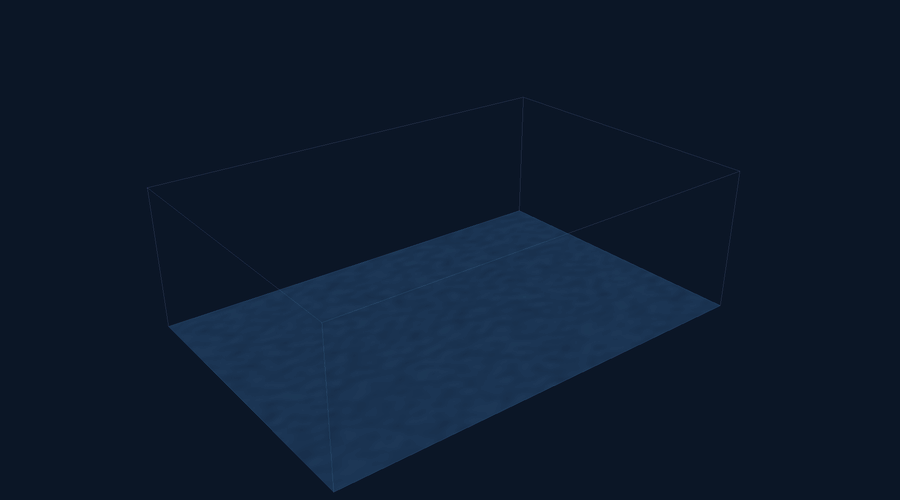
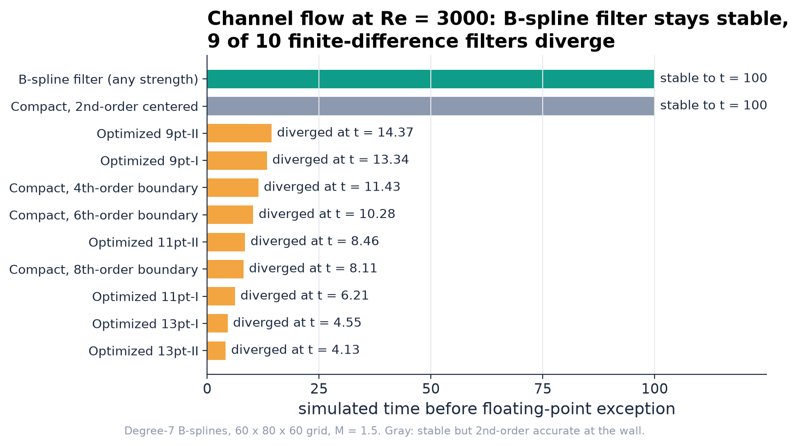
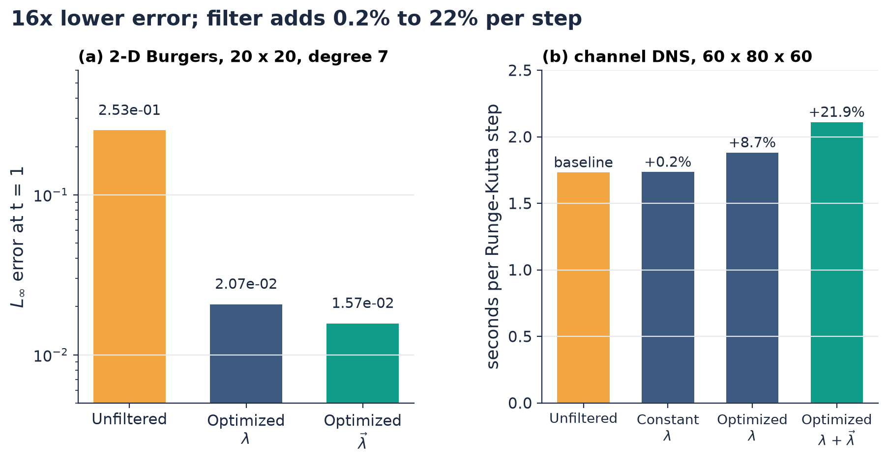
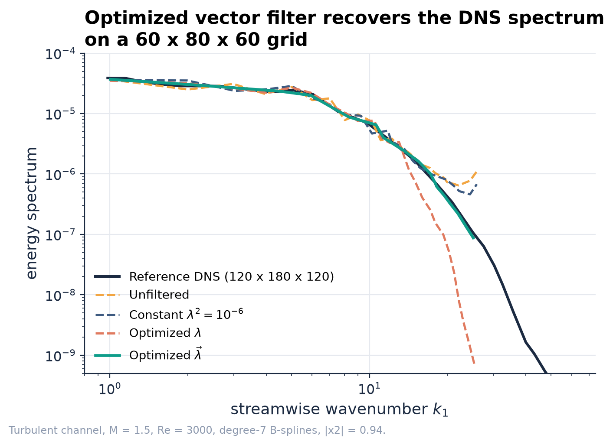
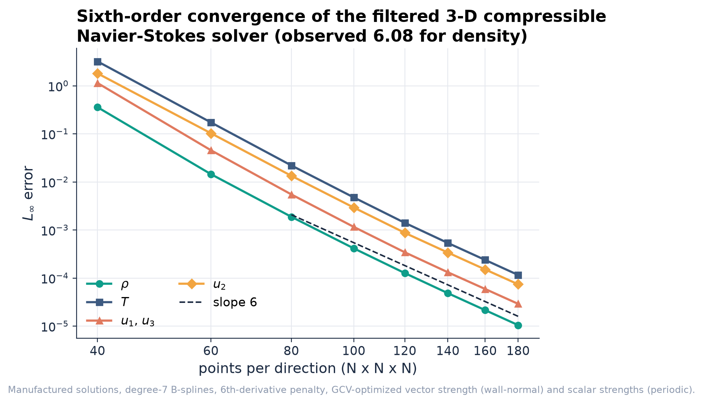
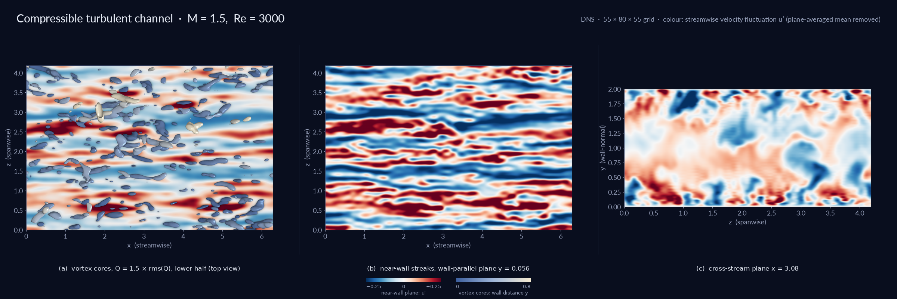
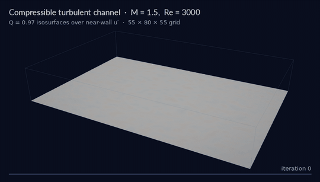

<p align="center">
  
</p>

# high-order-turbulence-dns

[](https://doi.org/10.1016/j.jcp.2020.109680)
[](https://github.com/bay-yearick-lab/high-order-turbulence-dns/actions/workflows/tests.yml)
[](LICENSE)
[](fortran/)
[](pyproject.toml)

Yong Yi Bay

High-order B-spline direct numerical simulation (DNS) of compressible wall-bounded turbulence, stabilized by a boundary-consistent B-spline operator whose strength is selected automatically every time step by generalized cross validation (GCV). The code accompanies Bay et al., Journal of Computational Physics 419 (2020).

## Overview

On an under-resolved compressible turbulent channel at Re = 3000, the B-spline stabilization runs stably to t = 100 while 9 of the 10 compact and optimized finite-difference stabilization schemes tested diverge between t = 4.1 and t = 14.4. The stabilization is provably non-amplifying on a bounded domain: its eigenvalues are real and lie in [0, 1] for every stabilization strength and every penalty, at the wall as well as in the interior. It cuts the error of an under-resolved 2-D Burgers solution 16x (2.53e-1 to 1.57e-2), recovers the reference DNS energy spectrum of the channel on a 60 x 80 x 60 grid, preserves sixth-order convergence of the 3-D compressible Navier-Stokes solver under manufactured solutions, and costs 0.2% to 22% per Runge-Kutta step depending on how the strength is chosen.

The stabilization strength is a data-driven solver control. Minimizing the GCV function balances how much the stabilization changes the solution against how many degrees of freedom it removes, so the stabilization switches on where aliasing builds up and stays off where the field is resolved, with no tuned threshold. Scalar strengths are optimized by Newton's method with closed-form gradients and Hessians from a pre-computed eigen-decomposition; a vector strength (one value per wall-normal basis function) uses an analytic gradient and a warm-started, cubically convergent iterative inverse that reaches round-off in two iterations per step.

The repository holds the Fortran 90 channel solver used for the paper's turbulence runs, a tested Python reference implementation of the stabilization, the GCV optimizer and the stability analysis, the original Python research scripts, and the data and scripts behind every figure here.

## Results

| Test | Result |
| --- | --- |
| Robustness, compressible channel, M = 1.5, Re = 3000, t in [0, 100] | B-spline stabilization stable at every strength. 9 of 10 finite-difference stabilization schemes diverge: compact with 4th/6th/8th-order boundary closures at t = 11.43 / 10.28 / 8.11, optimized 9/11/13-point stabilization schemes (two closures each) at t = 4.13 to 14.37. Only the 2nd-order centered compact closure survives |
| Linear stability on a bounded grid | B-spline stabilization eigenvalues real, in [0, 1]. Compact closures: max \|eig\| = 1.000426 (8th order), 1.000213 (6th), 1.000074 (4th), with imaginary parts up to 0.16. Optimized closures: max \|eig\| up to 1.005975, all with complex eigenvalues |
| Accuracy, 2-D Burgers, 20 x 20, degree 7, t = 1 | L∞ error 2.53e-1 unstabilized, 2.07e-2 optimized scalar, 1.57e-2 optimized vector: 16x lower |
| Spectral fidelity, turbulent channel, 60 x 80 x 60 | optimized vector stabilization matches the reference DNS (120 x 180 x 120) streamwise spectrum to the grid cutoff; unstabilized and constant-strength runs show an aliasing pile-up |
| Order of accuracy, 3-D compressible Navier-Stokes, manufactured solutions | degree-7 B-splines with the stabilization active: observed order 6.02 to 6.09 on all five variables between 160³ and 180³ (formal order 6) |
| Cost per Runge-Kutta step, 60 x 80 x 60 | +0.23% constant strength, +8.7% per-step scalar optimization, +21.9% vector optimization |
| Warm-started cubic inverse (vector strength) | at most 2 iterations to 1e-14 per step in the Burgers runs; `make verify`: mean 2.05 iterations to the round-off floor of a direct inverse |
| Newton-optimized GCV | 10 Newton iterations on a 20 x 20 field, 13 on a 60 x 80 x 60 field ([benchmarks](benchmarks/results.md)) |
| Stabilization consistency, smooth field | ‖Au − u‖∞ converges at order 7 to 10 under refinement at fixed strength: the stabilization preserves formal order |

<p align="center"></p>

**Figure 1.** Simulated time before floating-point exception for the turbulent channel at Re = 3000 (degree-7 B-splines, 60 x 80 x 60, M = 1.5). The one-sided boundary closures of compact and optimized finite-difference stabilization schemes have amplifying, complex eigenvalues and the runs blow up within 15 time units. The B-spline stabilization, whose spectrum is real and bounded by 1, runs to t = 100. At Re = 300 physical viscosity stabilizes every scheme.

<p align="center"></p>

**Figure 2.** (a) L∞ error of the under-resolved 2-D Burgers solution at t = 1, recomputed by `tools/make_readme_assets.py` with the Python solver. (b) Wall-clock time per Runge-Kutta step of the Fortran channel solver. A constant strength costs 0.2% because the banded LU of BᵀB + λ²P is factored once; the optimized cases pay for the per-step strength selection.

<p align="center"></p>

**Figure 3.** Streamwise energy spectra at |x₂| = 0.94 for the channel at M = 1.5, Re = 3000 on a 60 x 80 x 60 grid against reference DNS on 120 x 180 x 120. Without stabilization, energy piles up at the cutoff. The optimized scalar stabilization is stabilizing but dissipative; the optimized vector stabilization adds just enough dissipation to follow the DNS spectrum.

<p align="center"></p>

**Figure 4.** L∞ errors of the 3-D compressible Navier-Stokes solver under time-dependent manufactured solutions with high-wavenumber content (degree-7 B-splines, 6th-derivative penalty, stabilization active with optimized strengths). All variables converge at the formal sixth order.

<p align="center"></p>

**Figure 5.** Compressible turbulent channel, M = 1.5, Re = 3000, 55 x 80 x 55 B-spline collocation grid, iteration 138,000. (a) Q-criterion vortex cores over the near-wall streamwise velocity fluctuation, lower half-channel. (b) Near-wall streaks at y = 0.056. (c) Streamwise velocity fluctuation in the cross-stream plane x = 3.08.

<p align="center"></p>

**Figure 6.** Transition from a perturbed laminar profile to sustained wall turbulence, iterations 0 to 138,000 (Q = 0.97 isosurfaces over near-wall u′; M = 1.5, Re = 3000, 55 x 80 x 55 grid).

## Method

**Stabilization.** A field is represented with N clamped B-splines of degree d, u(x) = Σⱼ Bⱼ(x) αⱼ, collocated at N points, so B is a square banded matrix. The stabilized coefficients minimize the misfit plus a penalty on the p-th derivative,

$$\hat{\alpha} = \arg\min_\alpha \|u - B\alpha\|_2^2 + \alpha^T \Omega \alpha, \qquad P_{ij} = \int B_i^{(p)} B_j^{(p)}\,dx,$$

with Ω = λ²P (scalar strength) or Ω = LPL, L = diag(λ) (vector strength). The stabilization operator is

$$\hat{u} = A u, \qquad A = B\,(B^T B + \Omega)^{-1} B^T .$$

**Boundary consistency and stability.** The same formula applies at every point, wall points included: there are no one-sided closure stencils. For invertible B, A = (I + B⁻ᵀΩB⁻¹)⁻¹ with Ω positive semi-definite, so A is symmetric with eigenvalues 1/(1 + ν), ν ≥ 0, all real and in (0, 1]. The stabilization is dissipative for any λ, any p and any grid, and dispersion-free. Polynomials of degree below p lie in the null space of P and pass through unchanged, which is why formal order is preserved. In the generalized SVD of (B, B⁽ᵖ⁾) the stabilization factors are σᵢ² / (σᵢ² + λ²μᵢ²): components with small generalized singular value, the mesh-scale modes, are damped and the rest are kept, giving a sharper high-wavenumber cutoff than compact or explicit stabilization schemes of the same stencil width.

**Banded linear algebra.** BᵀB + Ω has half bandwidth d. It is factored with LAPACK banded LU (DGBTRF) and applied with DGBTRS; for a constant strength the factorization is computed once. In 2-D and 3-D the stabilization is the Kronecker product A₁ ⊗ A₂ ⊗ A₃ and is applied as 1-D line operators along each direction, never forming the tensor-product matrix. In the Fortran solver the periodic directions use FFT-diagonalized circulant solves and the wall-normal direction uses the banded LU.

**GCV-selected strength.** The strength minimizes

$$V(\lambda) = \frac{\frac{1}{N}\|u - A(\lambda)u\|_2^2}{\left[\frac{1}{N}\,\mathrm{tr}(I - A(\lambda))\right]^2}.$$

For scalar strengths, one per direction, the eigen-decomposition (BᵀB)^(−1/2) P (BᵀB)^(−1/2) = U diag(s) Uᵀ is computed once and S = B(BᵀB)^(−1/2)U is orthogonal, so Aₐ = S diag(1/(1 + μₐs)) Sᵀ with μₐ = λₐ². V, its gradient and its Hessian with respect to log μ are then closed-form sums over the transformed data ũ = (S₁ᵀ ⊗ S₂ᵀ ⊗ S₃ᵀ)u, and Newton's method (eigenvalue-shifted Hessian, Armijo backtracking) converges in 10 to 13 iterations with no matrix rebuilt or inverted at run time. For the vector strength the gradient follows from dA/dλₖ = −BQ⁻¹(dQ/dλₖ)Q⁻¹Bᵀ with Q = BᵀB + (λλᵀ)∘P.

**Warm-started cubic inverse.** Because λλᵀ ≈ 1e-4 changes little between steps, Q⁻¹ is refreshed from the previous step's inverse with the third-order hyperpower iteration

$$V_{k+1} = V_k\left(3I - 3QV_k + (QV_k)^2\right), \qquad I - QV_{k+1} = (I - QV_k)^3,$$

which reaches round-off in two iterations per time step.

**Channel solver.** The Fortran solver integrates the compressible Navier-Stokes equations in skew-symmetric convective form with degree-7 B-spline collocation in all three directions, a wall-clustered tanh mesh in the wall-normal direction, isothermal no-slip walls, a streamwise body force that balances the mean wall shear, and the low-storage third-order Runge-Kutta scheme with mass and momentum conservation enforced each step. Before each step it selects the stabilization strengths (three scalars, or two scalars plus an 80-entry wall-normal vector) by derivative-free principal-axis minimization and applies the stabilization.

### Where things live

| Component | File |
| --- | --- |
| Clamped B-spline basis, collocation points, penalty matrix P | [`python/bspline_filter/basis.py`](python/bspline_filter/basis.py) |
| Stabilization A = B(BᵀB + Ω)⁻¹Bᵀ, banded LU (DGBTRF/DGBTRS), Kronecker line operators | [`python/bspline_filter/filter.py`](python/bspline_filter/filter.py) |
| GCV objective, closed-form gradient and Hessian, Newton optimizer; vector GCV gradient | [`python/bspline_filter/gcv.py`](python/bspline_filter/gcv.py) |
| Warm-started cubic iterative inverse | [`python/bspline_filter/inverse.py`](python/bspline_filter/inverse.py) |
| Eigenvalue analysis, compact-stabilization boundary closures | [`python/bspline_filter/stability.py`](python/bspline_filter/stability.py) |
| Under-resolved 2-D Burgers test | [`python/bspline_filter/burgers2d.py`](python/bspline_filter/burgers2d.py) |
| Channel solver: operators, banded LU and FFT circulant solves | [`fortran/col_operator.f90`](fortran/col_operator.f90), [`fortran/col_linalg.f90`](fortran/col_linalg.f90), [`fortran/col_fft.f90`](fortran/col_fft.f90) |
| Channel solver: per-step stabilization-strength selection | [`fortran/col_linalg.f90`](fortran/col_linalg.f90) (`GCV`, `vector_GCV`), [`fortran/gcv_objectives.f90`](fortran/gcv_objectives.f90) |
| Channel solver: Runge-Kutta, body force, conservation, MMS source terms | [`fortran/rk.f90`](fortran/rk.f90) |
| Transfer functions, eigenvalue studies, KdV/Burgers/2-D Navier-Stokes research drivers | [`python/research/`](python/research/) |

## Layout

```
python/bspline_filter/   tested reference implementation (filter, GCV, inverse, stability, 2-D Burgers, verify)
python/research/         original research scripts: transfer functions, eigenvalue studies, 1-D/2-D Burgers,
                         Burgers turbulence, KdV, 2-D Navier-Stokes with manufactured solutions
fortran/                 3-D compressible channel solver (nsbs) with makefile and input file mix.in
fortran/third_party/     derivative-free minimizers (LGPL)
tests/                   pytest numerical validation
benchmarks/              timing and iteration benchmarks with results
scripts/                 figure scripts (filter eigenvalues on a bounded grid)
tools/                   README figure generation, channel renderer
data/channel_spectra/    streamwise energy spectra of the channel runs and reference DNS
paper/figures/           figures of the published paper
assets/                  README figures
```

## Building and running

**Python** (NumPy and SciPy; Python 3.10 or newer):

```bash
pip install -e ".[dev]"      # or: uv sync --extra dev
make verify                  # headline numbers, about 5 s
make test                    # 28 numerical validation tests
make bench                   # benchmarks/results.md
make assets                  # regenerate assets/
```

Expected output of `make verify`:

```
[1] Filter spectrum on a bounded grid (degree 7, 6th-derivative penalty)
    B-spline filter, N = 32/64/128, 5 scalar + 1 vector strength each:
      eigenvalues 1/(1+nu), min(nu)/max(nu) = -8.7e-17 (nu >= 0 to round-off)
      explicit operator: max |eig| = 1.000000, max |imag| = 1.9e-14
    Compact filter, 8th-order boundary closure: max |eig| = 1.000426, max |imag| = 0.160791
    Compact filter, 6th-order boundary closure: max |eig| = 1.000213, max |imag| = 0.095251
[2] Warm-started cubic inverse, N = 80, lambda lambda^T ~ 1e-4, 0.1% change per step
    iterations per step: mean 2.05, max 3; final residual <= 5.9e-14 (direct inverse: 3.2e-14)
[3] Newton-optimized GCV, 20 x 20 field, one strength per direction
    converged in 10 Newton iterations, lambda^2 = (6.07e-04, 5.93e-04)
[4] Filter consistency on a smooth field, u = exp(sin x), lambda^2 = 1e-6
    N:           24        32        48        64        96
    error:  1.9e-05   1.0e-06   2.7e-08   3.3e-09   1.8e-10
    observed order: 10.0, 9.0, 7.4, 7.1
[5] 2-D Burgers, degree-7 B-splines, 20 x 20 points, nu = 1/80, t = 1
    unfiltered        L_inf(u) = L_inf(v) = 2.53e-01
    optimized-scalar  L_inf(u) = L_inf(v) = 2.07e-02
    optimized-vector  L_inf(u) = L_inf(v) = 1.57e-02
    error reduction with the vector filter: 16.1x
```

**Fortran channel solver** (Intel Fortran with MKL ILP64 BLAS/LAPACK and FFTW3; 8-byte reals and integers):

```bash
cd fortran
make FFTW_INC=/path/to/fftw/include    # builds ./mixc
./mixc                                 # reads mix.in, writes snapshots to channel/{rho,u,v,w,T}/
```

`mix.in` sets the grid (Nx, Ny, Nz), domain, time step, B-spline degree, Reynolds and Prandtl numbers and mesh stretching. The driver called from `init` in `main.f90` selects the run: `channel_solve` (unstabilized), `GCV_channel_solve` (optimized scalar strengths), `restart_vector_GCV_channel_solve` (optimized vector strength in the wall-normal direction, restarted from a snapshot) or `mms_solve` (manufactured-solution verification). `tools/render_channel.py` renders the channel figures from the solver's Parquet snapshots.

## Citation

Bay et al., *Journal of Computational Physics* 419 (2020) 109680, [doi:10.1016/j.jcp.2020.109680](https://doi.org/10.1016/j.jcp.2020.109680).

## License

MIT ([LICENSE](LICENSE)). The Fortran solver also needs the principal-axis minimizer `praxis.f90` (LGPL, available from Netlib), placed in `fortran/third_party/`.


